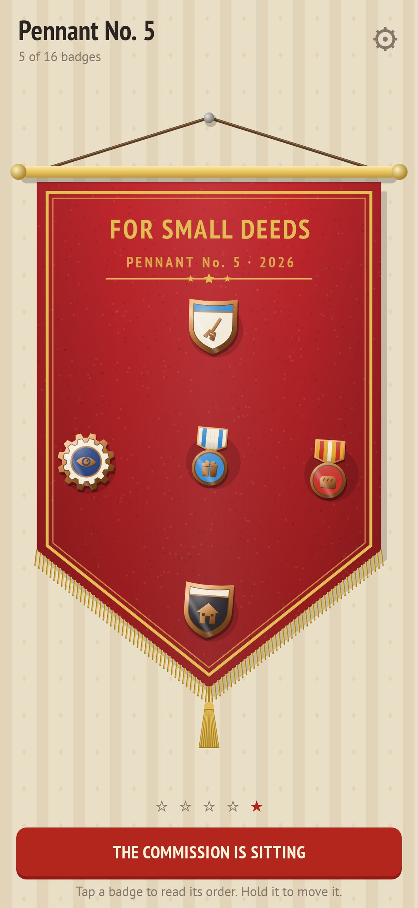
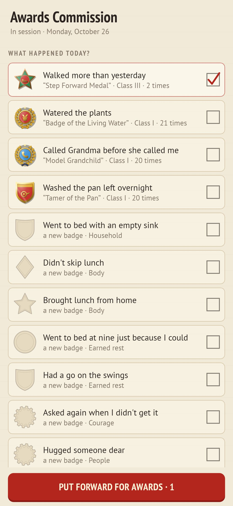
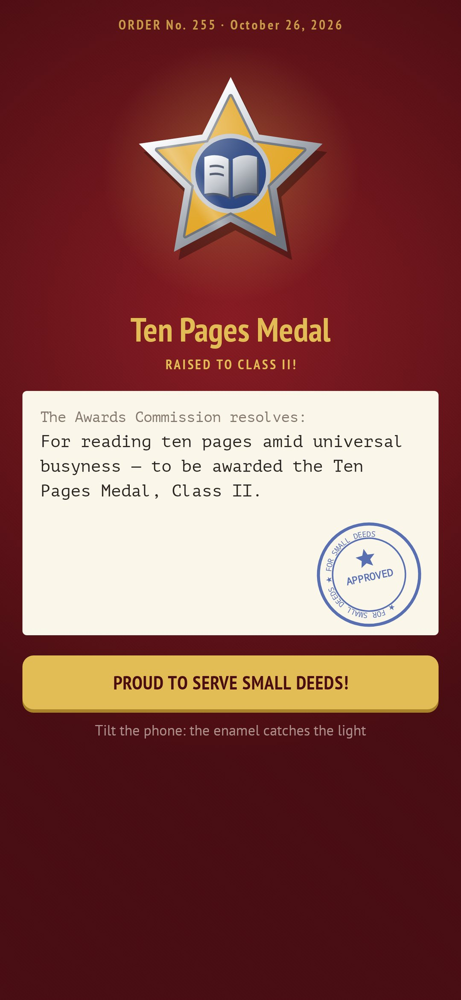
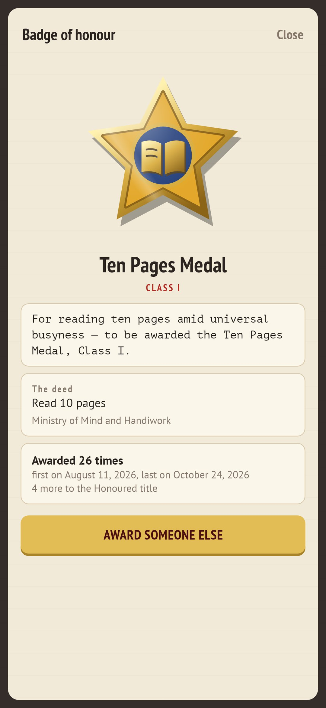
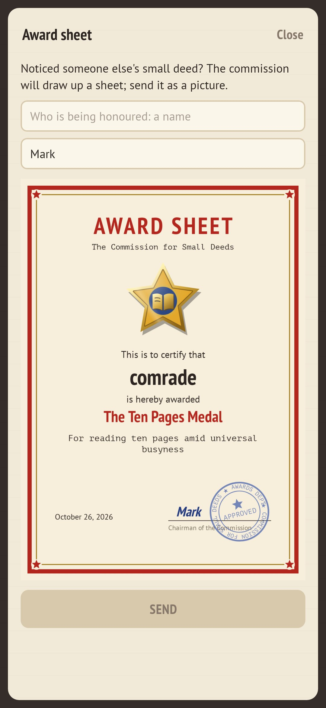

<div align="center">


# Small Honours

### Who said great deeds have to be big?

*Washed the pan left overnight. Called grandma first. Went to bed before midnight. Small Honours awards enamel pin badges for the small deeds of a day, with an order typed out, a rubber stamp and a fanfare. Nothing to plan, no streaks to break: in the evening the commission asks what happened, and the badges find you. Free, no ads, no account, no internet.*

[](https://github.com/bigdevwhale/honours/actions/workflows/android.yml)


[](LICENSE)

**English** · [Русский](README.ru.md) · [Changelog](CHANGELOG.md)

    

</div>

---

## How it works

1. **The commission sits.** In the evening you open the agenda: deeds you've done before, deeds that fit the hour and the season, and some you've never been honoured for. Tick what happened. Nothing is planned in advance, so there is nothing to fail.
2. **The ceremony.** Each badge rises on red velvet to a short brass fanfare. The order is typed out in chancellery style ("For unparalleled fortitude displayed in washing a pan left overnight…"), and the stamp comes down. Tilt the phone and the gloss slides across the enamel.
3. **Classes.** Do it again and the badge grows: bronze (Class III), silver at 5 awards, gold at 15, and the Honoured title at 30.
4. **The pennant.** New badges are pinned to a red felt pennant with a gold fringe. Hold one to move it. After 16 a new pennant goes up, and the old ones stay on the wall.
5. **Seven ministries, 337 deeds.** Household, Body, People, Out & about, Courage, Mind & hands, and the Ministry of Deserved Idleness, which honours *not* doing: no work chat after hours, twenty minutes lying down without a phone.
6. **The Order of the Day Survived.** On a hard day with nothing to tick, the commission awards an order simply for getting to the evening.
7. **Secret badges.** Some find you by themselves: the Night Watch, the Early Bird, the Return after a month of silence, the Shock Worker of Small Labour, the Standard-Bearer for a full pennant, Season Opened…
8. **The workshop.** Institute a badge of your own for a deed the list doesn't have: shape, two enamels, a stamped picture or one drawn on a 9×9 grid, and your own decree, with chancellery openers to start it.
9. **Award sheets.** Honour a friend, a colleague or your mum: the commission draws up a printed award sheet with the badge, the order, your signature and a blue stamp, shared as a picture.
10. **The record.** Every order by day, the whole collection to fill (earned badges in colour, the rest pressed blank into the paper), and the commission's yearly report.
11. **One invitation.** At the hour you choose, one quiet notification, «The commission is sitting», and only on a day that has no award yet.

## Build

```
./gradlew testDebugUnitTest assembleDebug
./gradlew -Pdemo assembleDebug          # app.honours.demo with two and a half months of sittings
./gradlew testDebugUnitTest -Prender --tests '*RenderArt*'   # badges, the pennant, the icon and every screen to app/build/art
python tools/shots.py app/build/art     # README screenshots from the renders
python tools/icon.py                    # launcher icon vectors
```

Everything is drawn in code: the badges (nine shapes, eight enamels, three metals, gloss) in `ui/art/Badge.kt`, the 54 stamped pictograms in `ui/art/Icons.kt`, and the felt pennant in `ui/art/Pennant.kt`. Sounds are synthesised on first launch. The deeds are in `app/src/main/assets/feats.tsv`.

Fonts: [PT Sans, PT Sans Narrow and PT Mono](https://fonts.google.com/?query=PT), SIL Open Font License.
