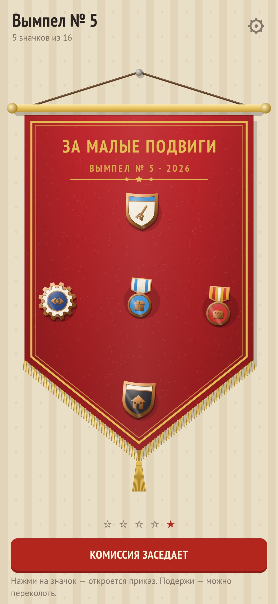
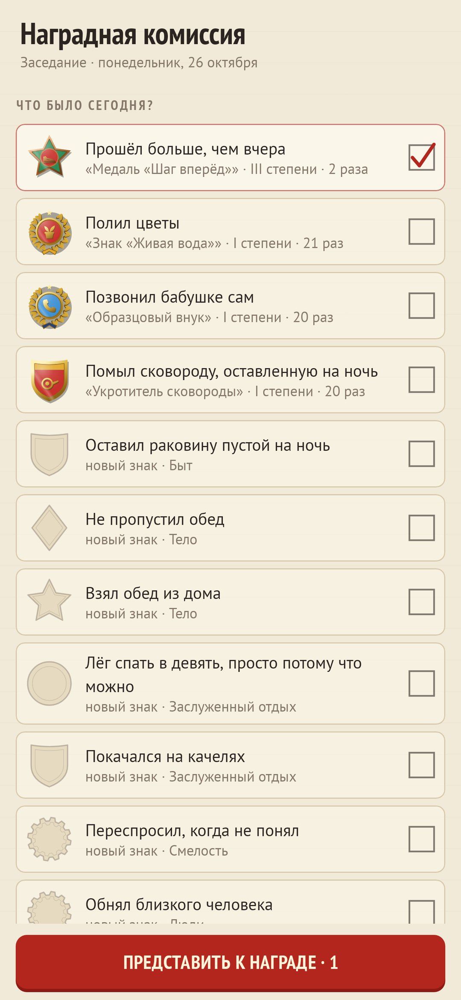
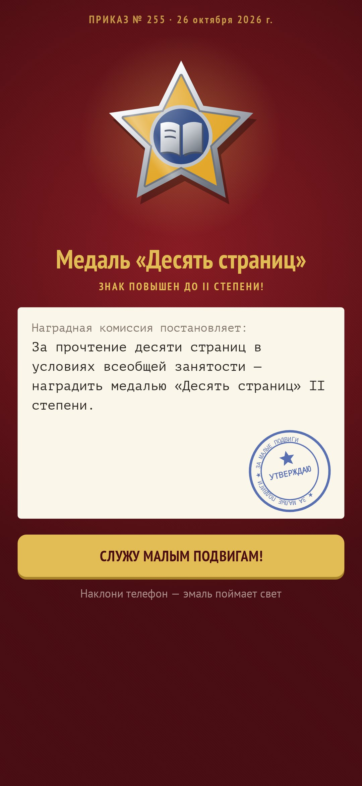
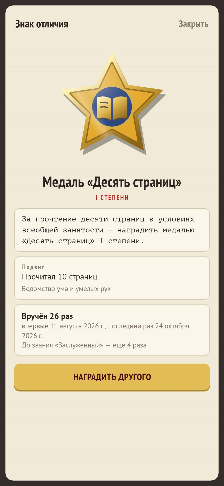
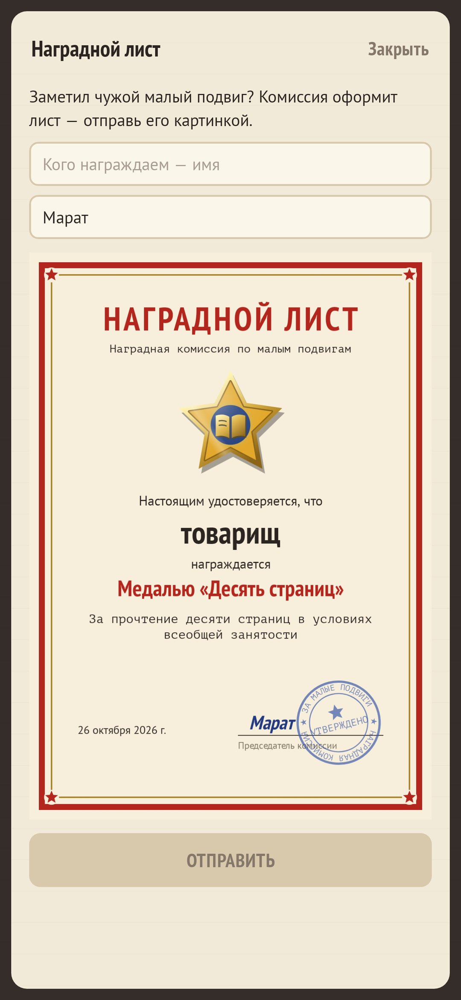

<div align="center">


# Значкист

### Кто сказал, что подвиги должны быть большими?

*Помыл сковороду, которая стояла с ночи. Позвонил бабушке первым. Лёг до полуночи. «Значкист» вручает за малые дела эмалевые значки — с приказом, отпечатанным на машинке, печатью и фанфарами. Ничего не нужно планировать, нечего «срывать»: вечером комиссия спрашивает, что было, и значки находят тебя сами. Бесплатно, без рекламы, без аккаунта, без интернета.*

[English](README.md) · **Русский** · [Изменения](CHANGELOG.md)

    

</div>

---

## Как это работает

1. **Комиссия заседает.** Вечером открываешь повестку: подвиги, которые уже бывали, подходящие к часу и сезону, и такие, за которые тебя ещё не награждали. Отмечаешь, что было. Ничего не планируется заранее — значит, нечего и провалить.
2. **Церемония.** Значок поднимается на красном бархате под короткую медную фанфару, приказ печатается канцелярским слогом («За беспримерную стойкость, проявленную при мытье сковороды, оставленной на ночь…»), опускается печать. Наклони телефон — блик скользнёт по эмали.
3. **Степени.** Повторил подвиг — знак растёт: бронза (III степень), серебро с 5 вручений, золото с 15, звание «Заслуженный» с 30.
4. **Вымпел.** Новые значки прикалываются на красный войлочный вымпел с золотой бахромой. Подержи значок — его можно переколоть. После 16 вешается новый вымпел, старые остаются на стене.
5. **Семь ведомств, 337 подвигов.** Быт, тело, люди, вылазки, смелость, ум и руки — и Ведомство заслуженного безделья, которое награждает за то, чего *не* сделал: не ответил в рабочий чат вечером, полежал двадцать минут без телефона.
6. **Орден Пережитого Дня.** В тяжёлый день, когда отметить нечего, комиссия вручает орден просто за то, что день прожит.
7. **Особые знаки.** Некоторые находят сами: «Ночной дозор», «Ранняя пташка», «Возвращение» после месяца тишины, «Ударник малого труда», «Знаменосец» за полный вымпел, «Сезон открыт»…
8. **Мастерская.** Учреди свой знак для подвига, которого нет в перечне: форма, две эмали, штамп или рисунок по сетке 9×9 и собственный указ — с канцелярскими заготовками.
9. **Наградные листы.** Награди друга, коллегу или маму: комиссия оформит наградной лист со знаком, приказом, твоей подписью и синей печатью — отправляется картинкой.
10. **Наградная книжка.** Все приказы по дням, вся коллекция (полученные знаки в цвете, остальные выдавлены в бумаге) и годовой отчёт комиссии.
11. **Одно приглашение.** В выбранный час — одно тихое уведомление «Комиссия заседает», и только если за день ещё не было наград.

## Сборка

```
./gradlew testDebugUnitTest assembleDebug
./gradlew -Pdemo assembleDebug          # app.honours.demo с двумя с половиной месяцами заседаний
./gradlew testDebugUnitTest -Prender --tests '*RenderArt*'   # значки, вымпел, иконка и все экраны в app/build/art
python tools/shots.py app/build/art     # скриншоты для README
```

Всё нарисовано кодом: значки (девять форм, восемь эмалей, три металла, блик) — `ui/art/Badge.kt`, 54 пиктограммы — `ui/art/Icons.kt`, вымпел — `ui/art/Pennant.kt`. Звуки синтезируются при первом запуске. Перечень подвигов — `app/src/main/assets/feats.tsv`.

Шрифты: PT Sans, PT Sans Narrow и PT Mono, SIL Open Font License.
